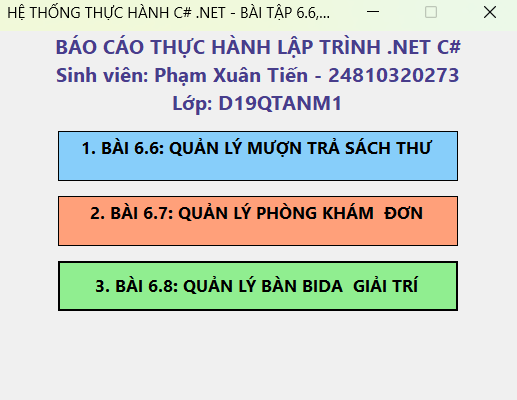
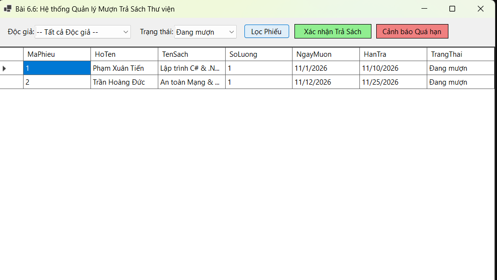
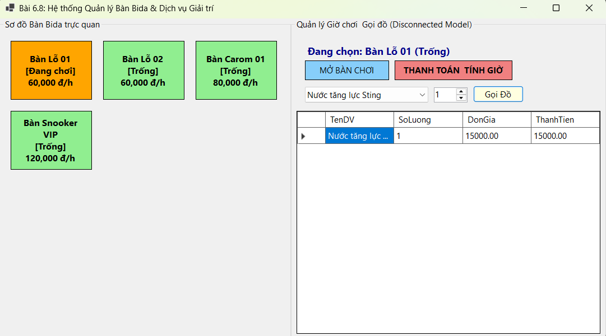
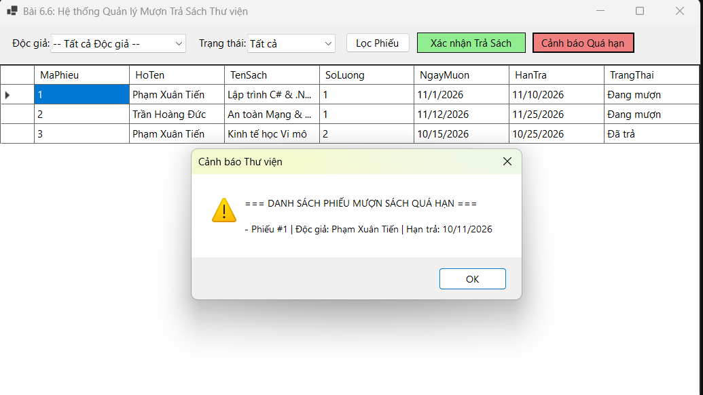
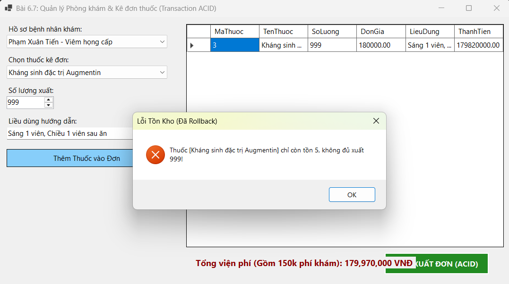

# BÁO CÁO BÀI TẬP THỰC HÀNH LẬP TRÌNH .NET C# (BÀI 6.6, 6.7, 6.8)

## MỤC 1: THÔNG TIN SINH VIÊN
- **Họ và tên sinh viên:** Phạm Xuân Tiến
- **Mã sinh viên:** 24810320273
- **Lớp / Khóa:** D19QTANM1 - Khoa Công nghệ Thông tin (EPU)
- **Tên Đề tài / Bài tập:** 
  - Bài 6.6: Hệ thống Quản lý Mượn Trả Sách Thư viện
  - Bài 6.7: Hệ thống Quản lý Phòng khám & Kê đơn thuốc
  - Bài 6.8: Hệ thống Quản lý Bàn Bida & Dịch vụ Giải trí

---

## MỤC 2: HƯỚNG DẪN CÀI ĐẶT & CHẠY DỰ ÁN
1. Khởi động MySQL trên **XAMPP Control Panel** (Port 3306).
2. Chạy tệp script SQL để khởi tạo 3 CSDL: `LibraryDB`, `ClinicDB`, `BilliardsDB`.
3. Mở Solution `Lab6Part3App.sln` bằng **Visual Studio 2022**.
4. Nhấn phím **F5** để khởi chạy Menu điều hướng tổng hợp (`frmMainApp`).

---

## MỤC 3: HÌNH ẢNH KẾT QUẢ CÁC MÀN HÌNH CHỨC NĂNG

### 1. Màn hình Chính / Tổng quan hệ thống

### 2. Màn hình Quản lý Danh mục (CRUD & Lọc phiếu mượn)

### 3. Màn hình Thực thi Nghiệp vụ chính (Visual Table Grid & Gọi món Bida)

### 4. Màn hình Báo cáo - Thống kê (Cảnh báo Sách quá hạn)

### 5. Minh họa An toàn Dữ liệu (Báo lỗi Transaction Rollback Kê đơn thuốc)

